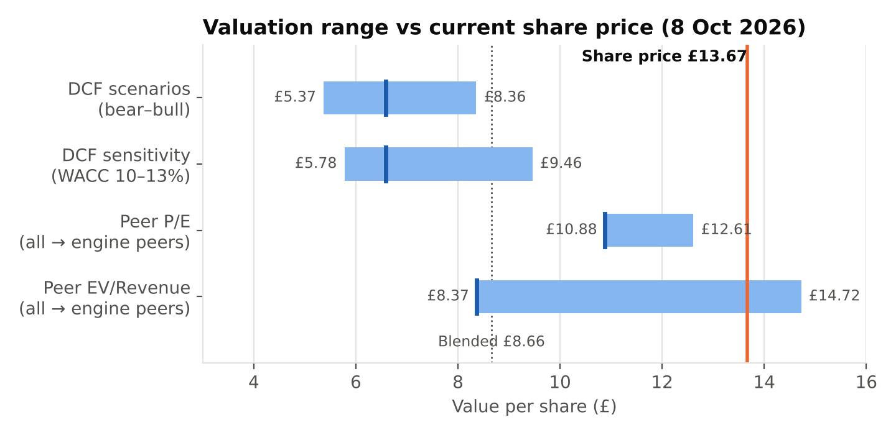
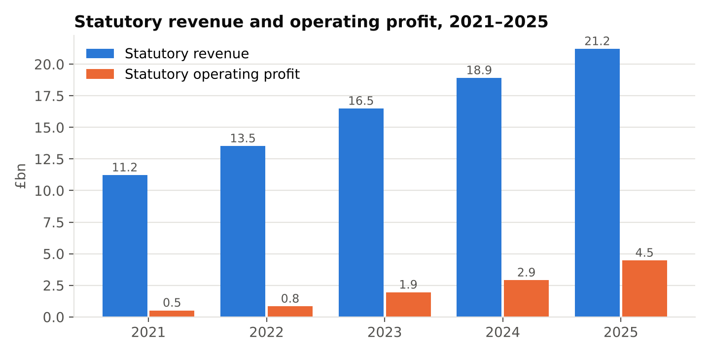
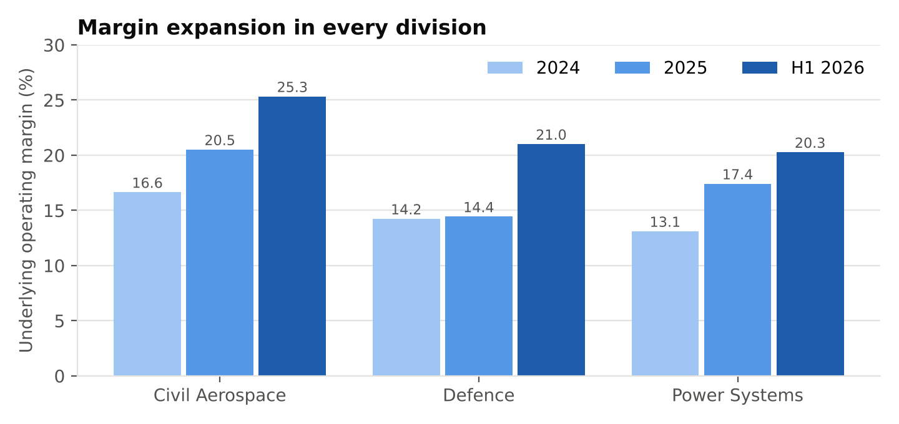
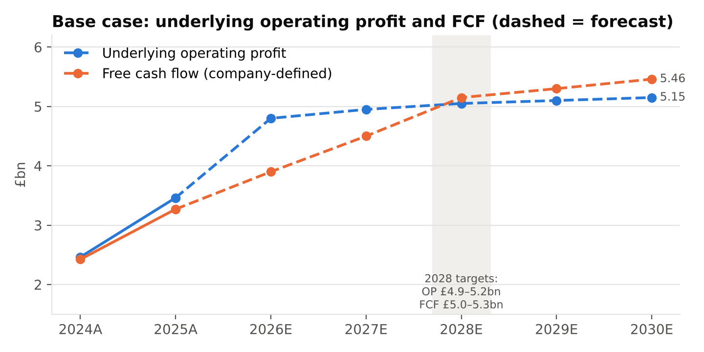
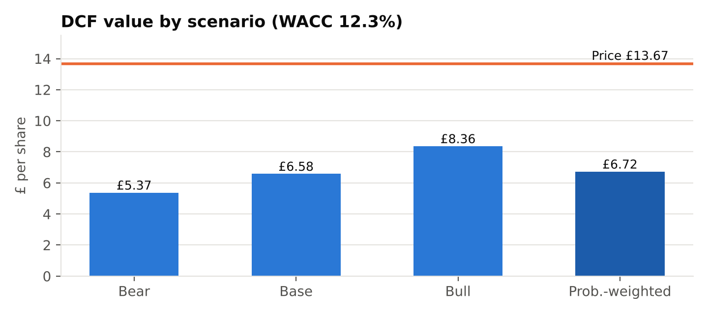

# Rolls-Royce Holdings plc — Independent Equity Research & Valuation

An end-to-end equity research project on **Rolls-Royce Holdings plc (LSE: RR.)**. It covers company and industry research, historical financial analysis, an earnings and cash-flow forecast, a DCF and peer valuation, Python share-price and event-study analysis, and a written investment recommendation.

**Valuation date:** 8 October 2026 (market data) · **Latest results used:** H1 2026 (30 July 2026)

> **Rating: SELL** | Blended fair value **£8.66** vs share price **£13.67** (−37%)
> A high-quality turnaround that the market has priced for considerably more than its published targets.

📄 **[Read the full report (PDF)](report/Rolls_Royce_Equity_Research_Report.pdf)** · 📊 [Valuation model (Excel)](model/Rolls_Royce_Equity_Research_Model.xlsx) · 🐍 [Python analysis (notebook)](analysis/Rolls_Royce_Share_Price_Analysis.ipynb) · 🖥️ [Presentation](presentation/Rolls_Royce_Investment_Presentation.pptx)

---

## Key findings

| | |
|---|---|
| **Business quality** | Strong. Statutory revenue CAGR of 17.3% (2021–25), operating margin up from 4.6% to 21.1%, free cash flow from £(1.5)bn to £3.3bn, net cash, and £7–9bn of buybacks planned for 2026–28 |
| **Valuation** | Stretched: 32.6x 2026E P/E and a 3.5% FCF yield |
| **DCF (FCFF / WACC 12.3%)** | £6.58 per share; bear £5.37, bull £8.36, probability-weighted £6.72 |
| **Peer multiples (LTM)** | P/E £10.88; EV/Revenue £8.37 |
| **Reverse DCF** | The share price needs cash flows about **2.1x** the base case (which already meets the 2028 targets), or a discount rate of about 7% |
| **Market risk** | 41.8% annualised volatility (FTSE 100: 12.6%), −55% maximum drawdown, beta 1.65 |



## What's in this repository

| Folder | Contents |
|---|---|
| [`report/`](report/) | Final equity research report (PDF and Word) and the stage-1 company and industry research document |
| [`model/`](model/) | Excel valuation model: inputs, historicals, ratios, segments, forecast, DCF, sensitivity, scenarios, reverse DCF, peer comps and 16 automated integrity checks |
| [`analysis/`](analysis/) | Python notebook: returns, volatility, beta, drawdowns, event windows and a market-model event study with significance tests |
| [`presentation/`](presentation/) | 14-slide investment presentation |
| [`images/`](images/) | Charts used in this README |

## Project workflow

1. **Company & industry research.** Business model, divisions, competitive position, SWOT, risks.
2. **Historical financial analysis.** Statutory financials 2021–2025 and growth, margin, cash-flow and balance-sheet ratios.
3. **Forecasting & valuation.** Underlying forecast to 2030 anchored on company guidance and 2028 targets. FCFF DCF at WACC, peer P/E and EV/Revenue, scenario analysis and a reverse DCF.
4. **Quantitative share-price analysis (Python).** Performance against the FTSE 100, risk metrics, and an event study around results announcements.
5. **Investment thesis & recommendation.** Bull and bear debate, risks to the rating, and what to monitor.
6. **Communication.** Written report and presentation.




## Methodology highlights

- **Underlying vs statutory.** Statutory results include large FX-hedge effects, so forecasts and valuation use underlying figures. The tax rate is normalised to 26% to strip out one-off deferred-tax credits.
- **DCF.** FCFF = company-defined FCF + after-tax net finance costs. Cash flows are discounted at WACC from the 30 June 2026 balance sheet with mid-period discounting. H1 2026 cash already received is removed to avoid double counting with net cash.
- **Cost of capital.** CAPM: UK 10-year gilt 5.43%, beta 1.58 (cross-checked against a Python regression estimate of 1.65), ERP 4.5%.
- **Relative valuation.** Trailing peer multiples (BAE Systems, Airbus, Safran, GE Aerospace) are applied to Rolls-Royce's trailing figures, so the bases match. Engine-only peers are shown as a cross-check.
- **Robustness.** WACC × terminal-growth sensitivity, bear/base/bull scenarios, and a reverse DCF showing what the market price implies.
- **Event study.** Market-model abnormal returns, estimated over trading days −250 to −30 before each event, with t-tests. For example, the FY2022 results produced an abnormal return of about +24% (p < 0.0001).




## Running the Python analysis

```bash
pip install -r analysis/requirements.txt
jupyter notebook analysis/Rolls_Royce_Share_Price_Analysis.ipynb
```

The notebook downloads prices from Yahoo Finance on first run and caches them to `analysis/data/prices.csv`, so results stay reproducible.

## Sources

The analysis relies mainly on primary sources: the Rolls-Royce 2025 Annual Report, the FY2022–FY2025 full-year results, the H1 2026 results, the July 2023 trading update and the November 2023 Capital Markets Day. Market data is a dated snapshot (8 October 2026) from StockAnalysis, the Financial Times and Investing.com. The full list with links is in the model's **Sources** tab and at the end of the report.

## Disclaimer

This is an independent educational project. It is **not investment advice** or a recommendation to buy or sell any security. Figures come from public disclosures and dated market data; forecasts are the author's assumptions.

---

**Author:** Ivan Tan · BSc Mathematics with Statistics, University of Bath
